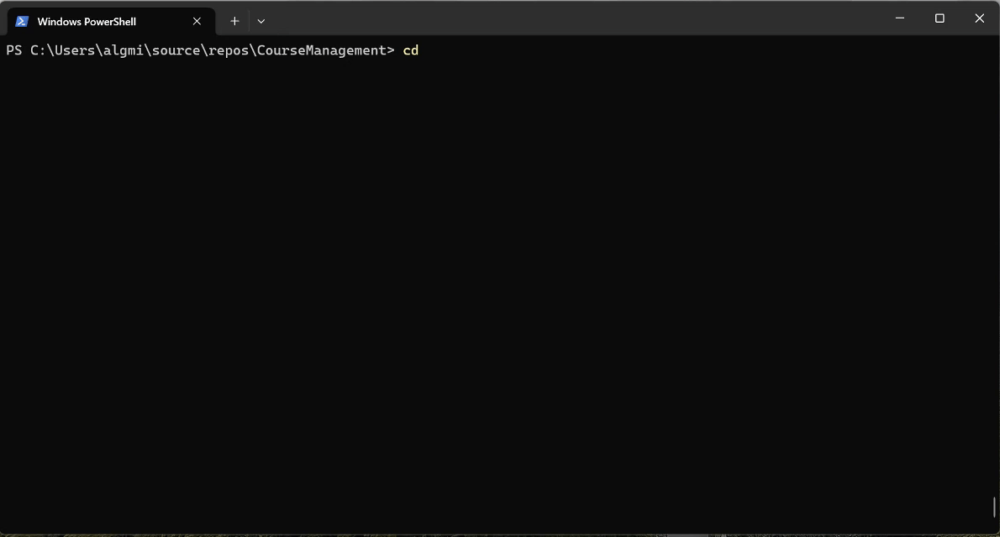

# CodeLines 📏

**A .NET CLI tool for counting meaningful lines of source code and tracking changes over time.**

CodeLines helps you explore how a codebase changes between scans. It skips blank lines, supports configurable exclusions for generated files and directories, and keeps a history of scan results.

[](https://www.nuget.org/packages/CodeLines)


## Preview



## Features

- Count source code lines while excluding empty lines.
- Customize file and directory exclusions with `.clineIgnore`.
- Compare a new scan with the previous results using `--diff`.
- View scan history for a project.
- Use a simple `cline` command from your terminal.

> **Scope:** CodeLines measures line counts; it does not attempt to measure developer productivity or code quality.

## Install

Install the published .NET tool:

```bash
dotnet tool install --global CodeLines
```

To update an existing installation:

```bash
dotnet tool update --global CodeLines
```

## Quick start

```bash
# Initialize ignore rules in the current directory
cline init

# Scan the current project
cline scan

# Compare with the previous scan
cline scan --diff

# Show recent scan history
cline history --last 5
```

## Command reference

| Command | Purpose |
|---|---|
| `cline init [--path|-p <project_directory>] [--force|-f]` | Create a `.clineIgnore` file; `--force` overwrites an existing one |
| `cline scan [--path|-p <project_directory>] [--diff|-d] [--verbose|-v]` | Count lines; optionally compare with previous results |
| `cline history [--path|-p <project_directory>] [--last|-l <number_of_entries>]` | Display previous scans |
| `cline ignore add <pattern> [--path|-p <project_directory>]` | Add an exclusion pattern |
| `cline ignore remove <pattern> [--path|-p <project_directory>]` | Remove an exclusion pattern |
| `cline ignore list [--path|-p <project_directory>]` | Show configured exclusions |

The default project directory is the current working directory when `--path` is omitted.

## Examples

Scan another directory:

```bash
cline scan --path ./my-project
```

Compare the current scan to the previous one:

```bash
cline scan --diff
```

Exclude generated files:

```bash
cline ignore add "**/*.Designer.cs"
```

View the last five scans:

```bash
cline history --last 5
```

## Configure exclusions

Run `cline init` to create a `.clineIgnore` file. The patterns use syntax similar to `.gitignore`:

```gitignore
# Build output
bin/
obj/

# Generated files
**/*.Designer.cs
**/Generated/*.cs
```

You can edit the file directly or use `cline ignore add` and `cline ignore remove`.

## When is it useful?

CodeLines can help with quick project inventories, tracking codebase growth, or checking how exclusion rules affect source line counts. Treat the results as descriptive statistics rather than a score of code quality.

## License

MIT.
